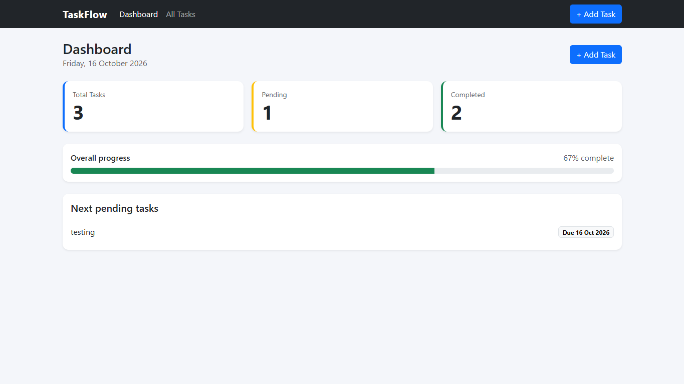
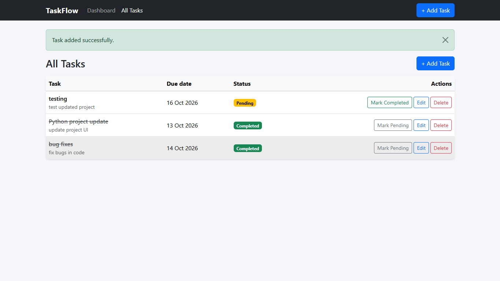
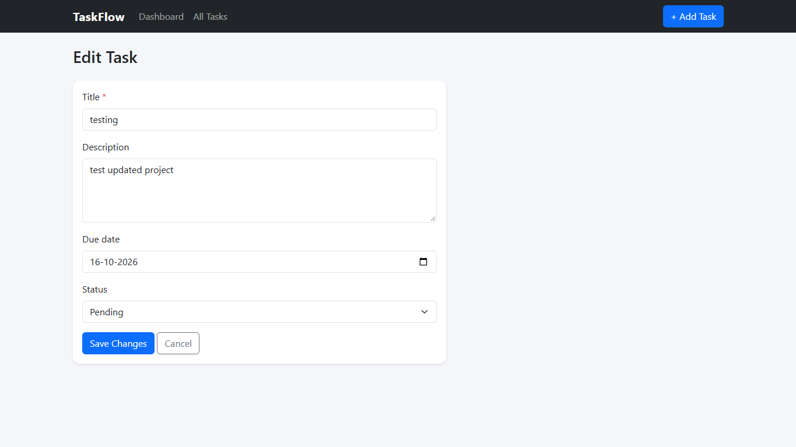

# TaskFlow — Task Management System

TaskFlow is a simple task management web application built with Python, Flask, MySQL, and Bootstrap. It helps users organize daily tasks, track their progress, and manage pending and completed work through a clean dashboard.


## 📸 Screenshots

### Dashboard


### Tasks


### Add Task



## Features

- Add new tasks with a title, description, and due date
- View all saved tasks
- Edit existing tasks
- Delete tasks
- Mark tasks as pending or completed
- View task statistics on the dashboard
- Responsive interface built with Bootstrap
- MySQL database for persistent storage

## Tech Stack

- **Backend:** Python, Flask
- **Database:** MySQL
- **Frontend:** HTML, CSS, Bootstrap 5
- **Configuration:** Python dotenv
- **Database Connector:** MySQL Connector/Python

## Project Structure

```text
TaskFlow/
├── app.py
├── config.py
├── db.py
├── requirements.txt
├── schema.sql
├── .env.example
├── .gitignore
├── README.md
├── templates/
│   ├── base.html
│   ├── dashboard.html
│   ├── tasks.html
│   ├── task_form.html
│   └── error.html
└── static/
    └── css/
        └── style.css
```

## Requirements

Before running this project, install:

- Python 3.9 or newer
- MySQL Server 8.x
- Git
- A code editor such as VS Code

## Installation and Setup

### 1. Clone the repository

Open PowerShell or the VS Code terminal and run:

```powershell
git clone https://github.com/bhupeshsaini7/TaskFlow.git
cd TaskFlow
```

### 2. Create a virtual environment

```powershell
python -m venv venv
```

Activate it:

```powershell
.\venv\Scripts\Activate.ps1
```

If PowerShell blocks activation, you can install packages without activating the environment by running `.\venv\Scripts\python.exe -m pip install -r requirements.txt` after completing the remaining setup.

### 3. Install dependencies

```powershell
python -m pip install -r requirements.txt
```

### 4. Create the MySQL database

Open MySQL Workbench and connect to your local MySQL Server.

Open a new SQL tab and execute:

```sql
CREATE DATABASE IF NOT EXISTS taskflow;
```

Next, open the project's `schema.sql` file, copy its contents into MySQL Workbench, and execute them to create the required table.

Verify the database and table:

```sql
USE taskflow;
SHOW TABLES;
```

The `tasks` table should be listed.

### 5. Configure environment variables

Create a local `.env` file by copying the example:

```powershell
Copy-Item .env.example .env
```

Open `.env` and fill in the values required by the application. For example, your configuration may look like this:

```dotenv
DB_HOST=localhost
DB_USER=root
DB_PASSWORD=your_mysql_password
DB_NAME=taskflow
SECRET_KEY=replace_with_your_own_secret_key
```

Use the exact variable names expected by `config.py`. If your existing `.env.example` uses additional settings, retain them.

**Important:** Replace the example values with your local configuration. Never upload `.env` or share real database credentials publicly.

### 6. Run the application

From the project directory, run:

```powershell
python -m flask --app app run --debug
```

Open your browser and visit:

http://127.0.0.1:5000

Keep the terminal open while using the application.

## Testing Checklist

After launching TaskFlow, check the following:

- [ ] Dashboard opens successfully.
- [ ] A new task can be added.
- [ ] Saved tasks appear in the task list.
- [ ] An existing task can be edited.
- [ ] A task can be marked pending or completed.
- [ ] A task can be deleted.
- [ ] Dashboard statistics update correctly.
- [ ] Tasks remain saved after restarting the application.

## Troubleshooting

### MySQL connection error

- Make sure MySQL Server is running.
- Check the host, username, password, and database name in `.env`.
- Verify that the `taskflow` database and required tables exist.
- Confirm that the database username has permission to access the database.

### `ModuleNotFoundError`

Install the required packages from the project directory:

```powershell
python -m pip install -r requirements.txt
```

### Flask command or application startup error

Run the command from the folder containing `app.py`:

```powershell
python -m flask --app app run --debug
```

If the application still fails to start, read the error message in the terminal and check the relevant file and configuration.

### Database or table not found

Open MySQL Workbench and execute:

```sql
USE taskflow;
SHOW TABLES;
```

If the required table is missing, review `schema.sql` and execute the appropriate table-creation statements.

### Port 5000 is already in use

Stop the other development server using that port, or start TaskFlow on another port:

```powershell
python -m flask --app app run --debug --port 5001
```

Then open http://127.0.0.1:5001.

## Security Notes

- Keep database credentials and secret keys in `.env`.
- Do not commit `.env` to GitHub.
- Keep `.env.example` limited to placeholder values.
- Use parameterized SQL queries when interacting with the database.
- This project is intended for learning and portfolio demonstration. Review security requirements before using it in production.

## Future Improvements

Possible future enhancements include:

- User authentication
- Task priorities and categories
- Search and advanced filtering
- Task reminders
- Export tasks to CSV
- Deployment to a hosting platform

## Author

**Bhupesh Saini**

GitHub: [@bhupeshsaini7](https://github.com/bhupeshsaini7)

## Repository

[View TaskFlow on GitHub](https://github.com/bhupeshsaini7/TaskFlow)
